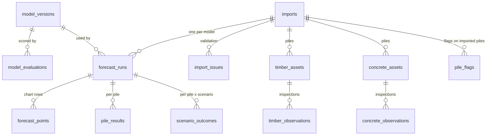

# Database Plan: Supabase for Imports and Model Results

**Status:** built (11 Oct 2026). The dashboard reads every chart from Supabase; the Import page validates, forecasts and saves uploads.

| What | Where |
| --- | --- |
| Client (secret key from `.streamlit/secrets.toml`) | `src/db/client.py` |
| Every read and write | `src/db/repository.py` |
| Upload → validate → forecast (both models) → save | `src/db/import_pipeline.py` |
| Chart data for the dashboard | `src/db/dashboard_data.py` |
| Load reference piles + model versions | `python -m src.db.seed_reference` (re-run after retraining) |
| Concrete RNN + Ridge, saved for imports | `python -m src.models.concrete_saved --save` → `artifacts/concrete_*` |
| 2-pile concrete sample upload | `data/samples/concrete_import_2_piles.xlsx` (`python -m src.data.make_concrete_sample`) |

Reference piles are stored as one import per material with `uploaded_by = 'Reference data'`. Concrete imports use the same saved RNN and Ridge as the reference piles (not the older `rnn_carbonation.pt` / `wc_regress` path in `concrete_forecast.py`). Invalid files are shown but not saved. The sections below are the original plan.
**SQL to copy and paste:** [`docs/database_schema.sql`](database_schema.sql)
**Scope for now:**
- **No login.** Every upload is visible to everyone using the app.
- **Port Kembla only,** for both timber and concrete.
- **Frontend changes only in `src/ui/dashboard.py`.** The other Streamlit pages (`timber_data_app.py`, `timber_results_app.py`, `timber_import_page.py`) are left as they are.

**Related:** [timber_import_guide.md](timber_import_guide.md), [concrete_import_guide.md](concrete_import_guide.md), [timber_model_updated.md](timber_model_updated.md), [concrete_model_comparison.md](concrete_model_comparison.md)

## 1. What this adds

Today the dashboard shows the reference piles (concrete PileA–G, timber PileB) from CSV files, and nothing a user does is kept. With Supabase (a hosted Postgres database with file storage), an engineer will be able to:

1. Download the skeleton for timber or concrete and clean their pile's data.
2. Upload it on the dashboard's Timber or Concrete page.
3. See it validated, with every problem listed.
4. See both models' forecasts side by side, exactly like the reference piles.
5. Find it again later in the same pile list, together with its forecasts, per-pile results and flags.

| What is stored | Table(s) |
|---|---|
| The saved models and their published scores | `model_versions`, `model_evaluations` |
| Each uploaded file and its validation result | `imports`, `import_issues`, plus the original file in the `imports` storage bucket |
| The piles and inspections in each import | `timber_assets`, `concrete_assets`, `timber_observations`, `concrete_observations` |
| Both models' forecasts | `forecast_runs` (one per model), `forecast_points` (the chart rows) |
| How well each model fits each pile, and its key outcomes | `pile_results`, `scenario_outcomes` |
| Maintenance/replacement flags, for reference and imported piles | `pile_flags` |

Everything is shared: with no login, any upload and any flag is visible to every user of the app.

## 2. What you need to do (about 15 minutes)

### 2.1 Create the project
1. Go to <https://supabase.com>, sign up (GitHub sign-in is easiest), and click **New project**.
2. **Name:** e.g. `port-pile-deterioration`. **Region:** *Sydney (ap-southeast-2)*. **Database password:** generate one and save it in a password manager (the app doesn't need it, but direct database access does).
3. Wait about 2 minutes for it to finish setting up.

### 2.2 Create the tables
1. Left menu → **SQL Editor** → **New query**.
2. Open [`docs/database_schema.sql`](database_schema.sql), copy **all** of it, paste it in and click **Run**. Expect *Success. No rows returned*.
3. Check it worked: run the three queries at the bottom of the file (section 12) on their own. You should see 14 names (13 tables plus the `forecast_points_dashboard` view), 10 model-score rows, and `rowsecurity = true` for all 13 tables.

The script is safe to run again; it only creates what's missing. You can also look at the tables under **Table Editor**.

### 2.3 Copy the keys into the project
1. **Project Settings** → **API Keys** (older projects: **Data API** / **API**). You need two things:
   - the **Project URL**, e.g. `https://abcdxyz.supabase.co`
   - the **secret** key (older projects call it **service_role**)
2. Put them in `.streamlit/secrets.toml` (create the file; it's already git-ignored), next to your existing Gemini key:

```toml
SUPABASE_URL = "https://abcdxyz.supabase.co"
SUPABASE_SECRET_KEY = "sb_secret_... (or the service_role key)"
```

**Why the secret key, and why that's safe here:** with no login, there's no user to restrict rows to. So the database is fully closed to the public (row security on, no policies), and only the Streamlit **server** talks to it, using the secret key. Streamlit runs all Python on the server, so the key never reaches anyone's browser. Don't put it in a frontend, a public repo or a chat channel; share it with teammates through a password manager or a private message.

### 2.4 Install the Python client and test the connection

```bash
.venv/Scripts/python.exe -m pip install "supabase>=2,<3"
```

```python
# scratch test, e.g. test_supabase.py
import tomllib
from supabase import create_client

secrets = tomllib.load(open(".streamlit/secrets.toml", "rb"))
db = create_client(secrets["SUPABASE_URL"], secrets["SUPABASE_SECRET_KEY"])
print(db.table("model_evaluations").select("model_version, evaluation, r2").execute().data)
```

If it prints the 10 model-score rows, everything is connected.

### 2.5 One more thing before concrete imports can run
The concrete RNN model file (`artifacts/rnn_carbonation.pt` and `.json`) isn't in this checkout. `artifacts/` only has the timber models. Either run `python -m src.models.train_final_model`, or copy the files from the teammate who trained it. Until then, concrete imports fail whether or not the database is set up.

### 2.6 Good to know
- **The free plan pauses a project after 7 days without activity.** Open the Supabase dashboard and click *Restore* if that happens. Before a demo, open the app the day before.
- **Free limits:** 500 MB database and 1 GB file storage. One timber import is about 160 forecast rows per model, so thousands of imports fit easily.
- **Backups:** the free plan has no point-in-time restore. Export important data from **Table Editor** → *Export to CSV* if needed.

When §2.1–2.4 are done (and §2.5 for concrete), tell me and I'll start on §5.

## 3. The design



Key choices:
- **One shared `imports` table, separate pile tables per material.** Timber and concrete piles have different columns (timber 15, concrete 4), so each gets a typed table with the same ranges the validators check. The database refuses anything impossible even if code changes later.
- **`forecast_points` uses the dashboard CSV's columns** (`asset_id, scenario, year, value, unit, metric, method`). The view `forecast_points_dashboard` adds `material` back, so an imported pile can be turned into the same chart data as a reference pile.
- **One forecast run per model per import,** recording which saved model version produced it, so every result traces back to the exact model file.
- **Deleting an import deletes everything under it** (issues, piles, inspections, runs, points, results, flags), via `on delete cascade`.
- **The original upload is kept** in a private storage bucket (`<material>/<import_id>/<file name>`), so any saved result can be re-run from the exact file.
- **`site` defaults to Port Kembla.** The column exists so other sites can be added later without changing the tables.

## 4. How an import flows through

```mermaid
sequenceDiagram
    actor E as Engineer
    participant D as dashboard.py
    participant V as Validator (timber_import / concrete_import)
    participant M as Saved models
    participant DB as Supabase
    E->>D: Timber or Concrete page -> "Import piles"
    D-->>E: template download
    E->>D: upload cleaned .xlsx
    D->>V: validate_import()
    V-->>D: errors + warnings
    alt has errors
        D-->>E: list every problem; nothing saved
    else valid
        D->>M: forecast with both models
        M-->>D: forecasts (+ anchor offsets)
        D->>DB: import, issues, file, piles, inspections, runs, points, results
        D-->>E: imported pile appears in the pile list
    end
    E->>D: select the imported pile any time later
    D->>DB: read forecast_points_dashboard
    D-->>E: same two charts as a reference pile
```

Example (concrete): an engineer cleans Pile G's data from the concrete skeleton and uploads it on the Concrete page. `concrete_import.validate_import` checks the 3 sheets. Errors are listed and nothing is saved. If the file is valid, the two concrete models forecast every climate scenario, and everything is saved. "Pile G (imported 8 Oct)" then appears in the pile list next to the reference piles, with the same two charts, flags and AI summary.

**Invalid files aren't saved.** Since everything is shared, storing broken uploads would only clutter the list. The engineer fixes the file and uploads it again. (If you'd rather keep a record of failed attempts, `imports.status = 'invalid'` already supports it.)

## 5. How I'll change the code once the database is online

The app keeps working at every step. If the Supabase keys aren't set (for example on a teammate's machine, or in tests), the dashboard behaves exactly as today: reference piles only, and the import button shows a short "database not configured" message.

### 5.1 Backend (new files; no UI code)

| Phase | What | Files |
|---|---|---|
| **1. Connection** | Read `SUPABASE_URL` / `SUPABASE_SECRET_KEY` from `st.secrets` or the environment (same pattern as the Gemini key in `ai_summary.py`); `is_configured()`; one cached client. | new `src/db/config.py`, `src/db/client.py`; `requirements.txt` (+ `supabase>=2,<3`) |
| **2. Saving and loading** | `save_import(...)`: upload the file, write the import, piles, inspections, both runs, points, `pile_results` and `scenario_outcomes`. `list_imported_piles(material)`, `imported_pile_data(material, import_id, asset_id)` (returns the **same** `{model: {"historical", "projection"}}` shape as `dashboard_timber_model_data` / `dashboard_concrete_model_data`, so the existing chart code works unchanged), `delete_import(import_id)`, and flag read/write. Row-building functions (`ImportResult` → issue rows, forecast DataFrame → point rows, per-pile metrics) are kept separate from network calls, so they can be unit-tested. | new `src/db/repository.py`, `src/db/rows.py` |
| **3. Import pipeline** | One function per material: validate → forecast with both models → per-pile results → `save_import`. Rejects any site other than Port Kembla. Timber needs one small addition: `timber_forecast.forecast_pile` must also return the model's predictions at the inspection years, for the fit scores. | new `src/db/import_pipeline.py`; `src/models/timber_forecast.py` (small) |
| **4. Model registry sync** | `python -m src.db.sync_models` reads `artifacts/timber_transfer_{gbm,mlp}.json`, `artifacts/rnn_carbonation.json`, `artifacts/wc_regression.json` and the benchmark results. It upserts `model_versions` (marking the current version active) and `model_evaluations`, and replaces the placeholder concrete names from §11 of the SQL. Run it after every model re-save. | new `src/db/sync_models.py` |

### 5.2 Frontend: only `src/ui/dashboard.py`

| Change | Where in `dashboard.py` | What the user sees |
|---|---|---|
| **Imported piles in the pile list** | `_render_timber_page`, `_render_concrete_page`, `_pile_controls` | The **Pile** dropdown lists the reference piles first, then imported ones, e.g. "Pile G · imported 8 Oct". Choosing an imported pile loads its data from the database instead of the CSVs; everything below (two charts side by side, larger view, AI summary) works the same. Pile IDs only need to be unique within an import, so the same name can be uploaded twice without clashing. |
| **"Import piles" dialog** | new `_import_dialog(material)` (an `st.dialog`, like the existing `_add_flag_dialog`), opened by a button under the pile list | Template download button (the existing `timber_import_template.xlsx` / concrete template) → file upload → optional "Your name" → **Validate**: a table of errors and warnings → if valid, **Forecast and save** with a spinner → the dialog closes and the new pile is selected. |
| **Per-pile results under the charts** | new `_imported_pile_summary(...)`, shown only for imported piles | A small table per model: number of inspections, fit to inspections (MAE/RMSE), the anchor shift with a warning if it's over 15 mm, and the replacement year per scenario (timber). |
| **Model scores** | new `_model_scores_expander(material)` | A collapsed "How accurate are these models?" section showing `model_evaluations`, labelled as tested on the reference data, not on this pile. |
| **Flags that persist** | `_add_flag_dialog`, `_pile_controls` | Flags are saved to `pile_flags` and stay after a restart, for reference and imported piles. The caption changes from "saved during the current session" to "saved for everyone". Without the database, it falls back to the current session-only behaviour. |
| **Delete an import** | under `_pile_controls`, imported piles only | A **Delete this import** button with an in-page confirmation (Streamlit can't show `confirm()` dialogs). It removes the import and everything under it. |
| **Tidy-up** | `_render_timber_page` | The "Backend response contract" expander is a developer note. I'd remove it or move it below everything else; your call. |

### 5.3 Tests and docs
- **Unit tests** for the row-building functions and for the repository against a fake client (no network in tests): `tests/test_db_rows.py`, `tests/test_db_repository.py`.
- **A check** that `imported_pile_data` returns exactly the same shape as the CSV loaders, so `dashboard.py` can't tell them apart.
- **Docs:** a "Saving and finding your import" section in both import guides, and this plan marked done.

### 5.4 What "performance of each pile" means for an import

An imported pile's future is unknown, so no forecast R² can be computed for it. What is stored per pile and model:
- **Fit to the pile's own inspections** (`fit_mae_mm`, `fit_rmse_mm`): the model's predictions at the inspection years against the measured values, before any anchoring. This is the honest "does the model suit this pile" number. For concrete, the RNN forecasts *from* the history rather than predicting it, so this stays empty until a fit measure is agreed.
- **The anchor shift** (timber) and whether it exceeded 15 mm (`large_offset`). That's the same warning the import already gives.
- **Outcomes per scenario** (`scenario_outcomes`): the value in 2050, the final value, and for timber the year the diameter reaches `replacement_diameter_mm`.
- **The models' general accuracy** stays in `model_evaluations` (PileB for timber, the 49-series benchmark for concrete). These are tests on the reference data, not on the imported pile, and the page labels them that way.

## 6. Decisions I need from you

1. **Which two concrete models run on an import?** The Concrete page shows **RNN vs Ridge**, and an imported concrete pile will appear on that same page, so ideally it shows the same two. But the import can only forecast with **RNN** and **wc_regress** today, and there's no saved Ridge model. Options:
   - **RNN + Ridge** (matches the page). Needs a saved Ridge model plus forecast support first, about half a day of backend work. **My recommendation**, since imported and reference piles then look the same.
   - **RNN + wc_regress** (works now). The right-hand chart would be titled "wc_regress" for imported piles and "Ridge" for reference piles.
2. **Should invalid uploads be saved?** Recommended **no** (§4), since everyone sees everything.
3. **Keep the original uploaded files?** Recommended **yes** (private bucket). It costs almost nothing and makes results reproducible.
4. **The "Backend response contract" expander on the Timber page:** remove it, or keep it at the bottom?

## 7. Security, given there's no login

- **Anyone who can open the app can see, add and delete every import.** That's fine for a team and supervisor demo. Before the app is shared with a public link, add at least a simple access gate; the tables can take row security policies later without being redesigned.
- **The database itself is closed to the internet:** row security is on with no policies, the storage bucket is private, and the public (anon/publishable) key can read nothing. Only the Streamlit server, holding the secret key in `.streamlit/secrets.toml` (git-ignored), can read or write.
- **If the secret key leaks,** rotate it in **Project Settings** → **API Keys** and update `secrets.toml`.
- **Deleting is permanent** (free plan, no point-in-time restore). That's why the delete button asks for confirmation.

## 8. Order of work

1. You: §2.1–2.4 (and §2.5 for concrete), then answer §6.
2. Me: Phases 1–3, then the import dialog and imported piles in the pile list. You can then upload, validate, see both models and find the pile again later.
3. Me: per-pile results, model scores, saved flags, delete.
4. Me: model registry sync, tests, docs.
